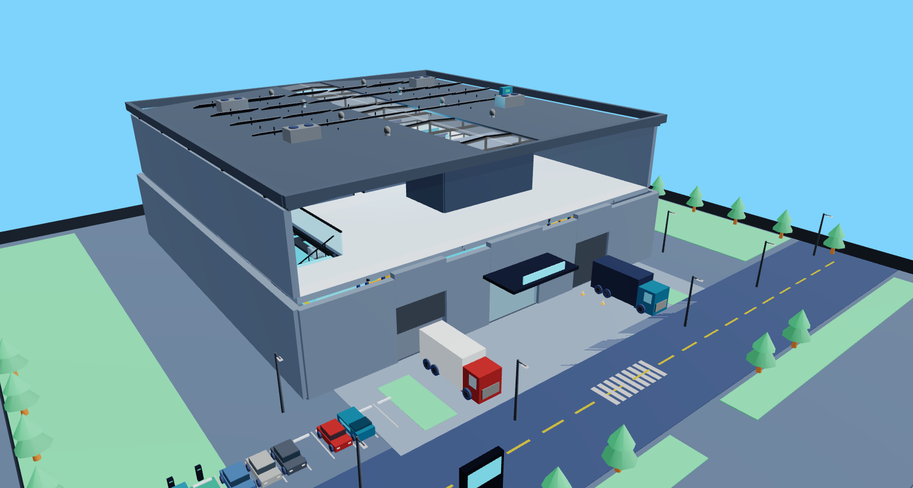
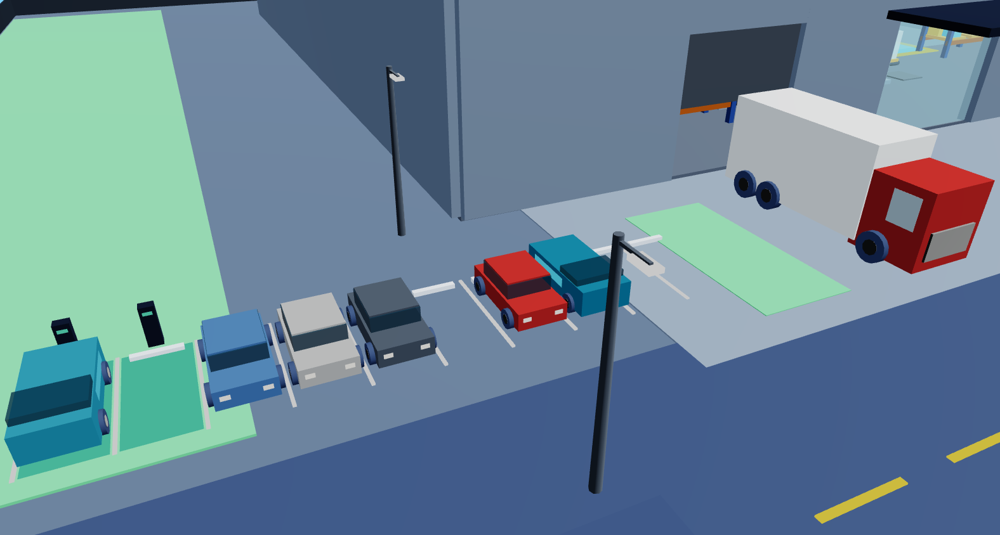
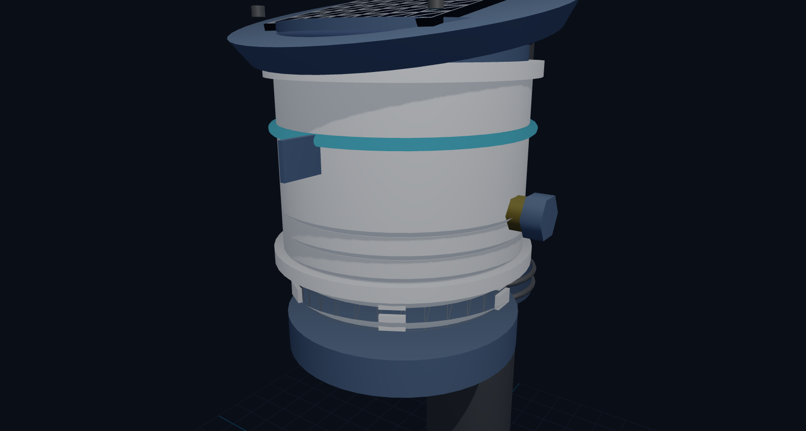
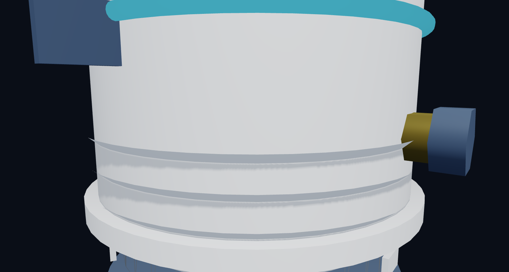
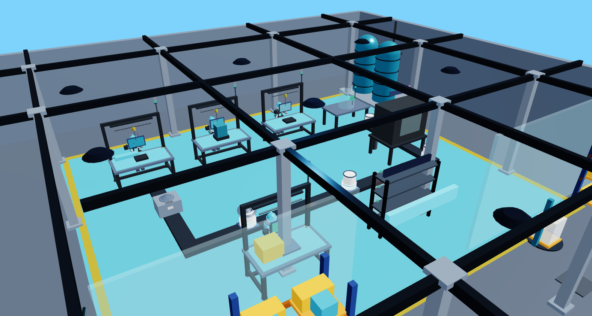
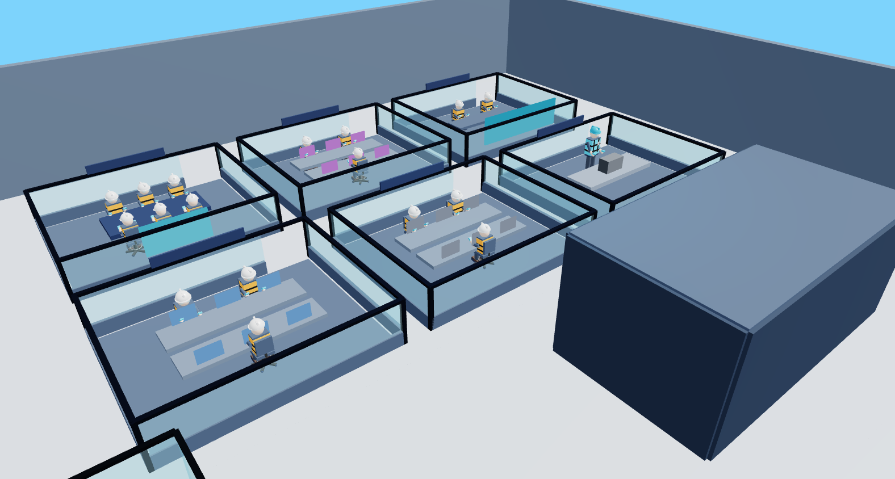
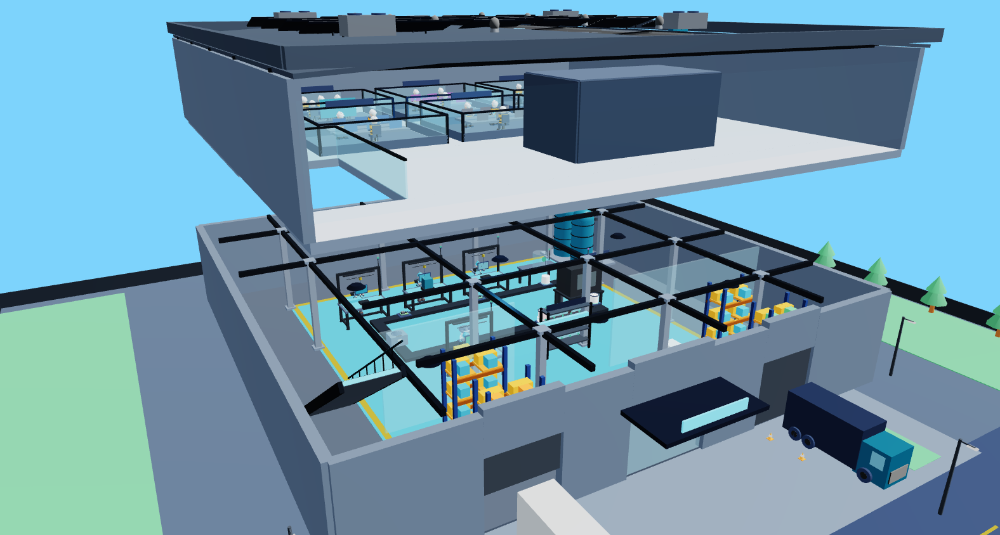

# Manual de Operación y Planta: Complejo Industrial y Corporativo OTech AirNet
**Especificación de Fabricación, Ensamble Modular, Campus Exterior y Sede Administrativa de Dos (2) Pisos**  
**Capacidad de Producción: 500 estaciones al mes (Aproximadamente 25 estaciones por día)**

---

## 1. Resumen General del Complejo y Campus de Dos Pisos

El complejo industrial y sede corporativa de **OTech S.A.S.** está construido sobre un terreno que integra áreas exteriores de transporte y un **edificio moderno de dos (2) plantas** con un área total de **$800 \text{ m}^2$** ($400 \text{ m}^2$ por piso, en una base de $20.0 \text{ m} \times 20.0 \text{ m}$):

1. **Campus Exterior, Vías de Acceso y Logística**:
   * **Zona de parqueaderos**: 10 puestos delimitados para vehículos de empleados y visitantes, con topes de seguridad y andenes peatonales.
   * **Puestos de recarga para vehículos eléctricos (EV)**: 2 bahías señalizadas en color verde con cargadores rápidos para movilidad ecológica.
   * **Patio de maniobras y muelle de carga**: Espacio amplio pavimentado para que los camiones descarguen componentes e insumos, y carguen los pedidos terminados para su entrega.
   * **Vía de acceso**: Calle pavimentada de doble carril con demarcación vial, paso peatonal estilo cebra y garita de control de seguridad.

2. **Piso 1 (Nivel 0.00m - Fabricación, Pruebas y Logística - $400 \text{ m}^2$)**:
   * Muelle de recepción para revisar las piezas que llegan de proveedores.
   * Bodega de piezas y componentes organizada para surtir la línea de trabajo.
   * **Zona de trabajo con piso azul antiestático**: Superficie especial que elimina la electricidad estática para proteger los circuitos electrónicos de cualquier descarga.
   * **Línea de armado en forma de 'U'**: Siete (7) mesas de trabajo conectadas mediante una banda transportadora de rodillos, donde el equipo avanza paso a paso desde el armado inicial hasta el empaque final.
   * Muelle de empaque y salida de producto terminado hacia los camiones.
   * Zona de vestieres y baños del personal operativo.
   * Escalera metálica amplia y montacargas para subir materiales al segundo piso con seguridad.

3. **Piso 2 (Nivel +3.80m - Oficinas, Desarrollo de Software y Monitoreo - $400 \text{ m}^2$)**:
   * **Recepción y vitrina de exhibición (Showroom)**: Mesa interactiva con estaciones funcionando en vivo para clientes y visitantes.
   * **Gerencia General y Junta Directiva**: Oficina principal con ventanales y gran sala de reuniones ejecutiva para 10 personas con pantalla de video.
   * **Área de Desarrollo de Software e Inteligencia Artificial**: Mesas amplias de trabajo (*Open-Dev*) donde los programadores crean la aplicación web, el software de los sensores y los análisis de calidad del aire.
   * **Centro de Operaciones y Monitoreo (NOC 24/7)**: Sala con una pared de pantallas (*Video Wall*) que vigila día y noche que todas las estaciones instaladas en el país estén funcionando y transmitiendo datos.
   * **Taller de Hardware y Diseño**: Espacio para ingenieros electrónicos con estaciones de soldadura, instrumentos de medición e impresoras 3D.
   * **Balcón mirador con vidrio de seguridad**: Permite observar toda la línea de fabricación del primer piso sin tener que bajar a la zona de ensamble.
   * **Cuarto de servidores (Data Center)**: Espacio refrigerado con baterías de respaldo para guardar de forma segura toda la información de los clientes.

### Metas Clave de Producción
* **Producción mensual**: 500 estaciones listas y probadas al mes.
* **Producción diaria**: 25 unidades al día (en un turno normal de 8 horas de trabajo).
* **Tiempo promedio por estación (Takt Time)**: 16.8 minutos por unidad a lo largo de la línea.
* **Equipo de trabajo**: 5 operarios en planta (Piso 1) + 18 profesionales en ingeniería, software y administración (Piso 2).

---

---

## 2. Descripción de la Estación Exterior OTech AirNet

### 2.1. ¿Cómo nació el equipo y en qué mejora a CanAirIO?
La estación exterior **OTech AirNet** fue desarrollada a partir del proyecto de código abierto CanAirIO. Los prototipos iniciales de ciencia ciudadana solían usar cajas plásticas sencillas que podían dañarse con el agua o el calor. 

OTech rediseñó el equipo para convertirlo en un producto industrial resistente a la intemperie:
* Su carcasa está sellada de forma hermética para que no le entre lluvia ni polvo (protección IP65).
* Se alimenta mediante su propio panel solar y una batería recargable que le da hasta 3 días de energía continua aunque no haya sol.
* Cuenta con una cámara protectora que deja pasar el aire para medirlo pero frena las gotas de lluvia y los insectos.

### 2.2. Partes Principales de la Estación (Diseño Modular en 5 Partes)
1. **Tapa superior con panel solar**: Tiene una inclinación de 12° para que el agua de lluvia resbale rápido y no se acumule suciedad. Lleva montado un panel solar de 5W y un empaque de caucho que sella la unión con la caja.
2. **Caja principal protectora**: Carcasa resistente que cuida las partes electrónicas, la batería y la tarjeta de comunicaciones. Cuenta con tapones de caucho especiales para que los cables pasen sin dejar entrar humedad.
3. **Cámara de toma de aire**: Cilindro con aletas inclinadas hacia abajo que permiten la entrada del viento para medir la calidad del aire pero evitan la entrada de lluvia. Incluye una malla metálica muy fina que impide el paso de mosquitos y bichos.
4. **Bandeja deslizable de sensores**: Bandeja interna que sujeta los sensores. Si un sensor necesita mantenimiento o calibración, el técnico simplemente desliza la bandeja y coloca una nueva en menos de 2 minutos, sin necesidad de desmontar el equipo del poste.
5. **Soporte de montaje para poste o pared**: Abrazadera metálica trasera de acero inoxidable que permite fijar la estación de forma segura a cualquier poste de luz o atornillarla a una pared.

### 2.3. Componentes y Sensores del Equipo

| Pieza / Componente | Nombre Comercial | ¿Para qué sirve en la estación? | Datos Principales |
| :--- | :--- | :--- | :--- |
| **Procesador principal** | ESP32-S3 (Microcontrolador) | Es el cerebro del equipo: lee los sensores, guarda los datos y los envía a internet. | Conexión Wi-Fi y Bluetooth integrados. |
| **Sensor de polvo y humo** | Sensirion SPS30 | Mide la cantidad de polvo fino y humo en el aire (partículas PM2.5 y PM10) con un haz de luz láser. | Sensor de alta precisión con autolimpieza. |
| **Sensor de clima** | Bosch BME680 | Mide la temperatura del ambiente, la humedad del aire y la presión atmosférica. | Rango de -40 °C a 85 °C y 0 a 100% humedad. |
| **Sensor de dióxido de carbono** | Sensirion SCD41 | Mide la concentración de CO2 en el aire para saber qué tan ventilado o contaminado está el lugar. | Rango de 400 a 5.000 partes por millón. |
| **Módulo de largo alcance** | Semtech LoRaWAN / Celular | Permite enviar los datos de calidad del aire a kilómetros de distancia en zonas donde no hay Wi-Fi. | Cobertura de 5 a 15 km de distancia. |
| **Controlador de carga solar** | Módulo regulador MPPT | Regula la energía del sol para alimentar el equipo y recargar la batería de forma segura. | Aprovechamiento eficiente de la energía solar. |
| **Batería recargable** | Batería LiFePO4 (3.2V) | Almacena energía para mantener la estación funcionando hasta 3 días seguidos sin luz del sol. | Batería muy segura que dura más de 2.500 cargas. |
| **Panel solar integrado** | Módulo de 5W | Capta la luz del día para recargar la batería de forma automática sin enchufar a la pared. | Material resistente al sol y al agua de lluvia. |

---

## 3. Funcionamiento de la Planta en el Piso 1 (Fabricación y Pruebas)

Toda la producción se realiza en una línea en forma de 'U' para que los materiales no se crucen y el trabajo fluya de manera ordenada a través de siete (7) mesas o estaciones:

### Las 7 Estaciones de la Línea de Producción:

| Estación de Trabajo | Tiempo Estimado | ¿Qué se hace en esta estación? (Explicación sencilla) |
| :--- | :--- | :--- |
| **Estación 1: Armado de la base y sensores** | 12.5 minutos | Se colocan los sensores de polvo, clima y gases en la bandeja interna usando herramientas ajustadas y soportes de goma antivibración para proteger las piezas delicadas. |
| **Estación 2: Programación y prueba electrónica** | 8.0 minutos | Se conecta la tarjeta a un equipo de prueba rápida, se le instala el software de OTech, se guardan las claves de seguridad digital y se comprueba que gaste poca batería. |
| **Estación 3: Armado final y sellado de la caja** | 14.0 minutos | Se coloca la batería recargable dentro de la caja protectora, se pone el empaque de caucho y se ajustan los tornillos y protectores de cables para que no entre agua. |
| **Estación 4: Prueba de sello contra agua (Hermeticidad)** | 5.0 minutos | Se inyecta aire a presión durante un minuto para verificar con un manómetro que la caja esté 100% sellada contra la lluvia sin necesidad de mojar el equipo. |
| **Estación 5: Calibración con muestras patrón** | 3.0 min netos por unidad | Se colocan las estaciones dentro de una cámara de prueba con muestras conocidas de gas y polvo para verificar que midan exactamente lo que deben. |
| **Estación 6: Prueba de encendido continuo (48 horas)** | Proceso automático | Las estaciones se dejan encendidas 48 horas seguidas en una estantería especial cambiando entre frío y calor para asegurar que ninguna pieza falle al salir a la calle. |
| **Estación 7: Revisión final, empaque y despacho** | 10.0 minutos | Se limpia el equipo, se revisa visualmente, se le pega la etiqueta con su código y número de serie, y se empaca en su caja con manual y accesorios para entrega. |

---

## 4. Distribución del Piso 2 (Oficinas Corporativas, Software y Monitoreo)

El segundo piso está organizado con oficinas luminosas y divisiones de vidrio transparente para facilitar la comunicación entre los equipos de trabajo:

| Área del Piso 2 | ¿Quiénes trabajan allí? | ¿Qué hay en este espacio? (Explicación sencilla) |
| :--- | :--- | :--- |
| **Gerencia General (CEO)** | Gerente general y asistente | Oficina de presidencia con ventanales grandes y sala de juntas con mesa para 10 personas y pantalla de video para reuniones importantes. |
| **Equipo de Software y Datos (CTO)** | Programadores e ingenieros de datos | Mesas amplias de trabajo con pantallas dobles donde se desarrolla la aplicación web, el software de los sensores y la inteligencia artificial. |
| **Centro de Operaciones (NOC 24/7)** | Técnicos de monitoreo y soporte | Sala con una pared de pantallas (*Video Wall*) para vigilar en tiempo real que todas las estaciones instaladas en las ciudades estén transmitiendo datos. |
| **Laboratorio de Hardware (R&D)** | Ingenieros electrónicos | Taller técnico con mesas de soldadura, instrumentos de medición e impresoras 3D para diseñar mejoras y probar nuevos modelos. |
| **Cuarto de Servidores (Data Center)** | Ingenieros de sistemas | Habitación segura y refrigerada con baterías de respaldo y servidores para almacenar la información de los clientes. |
| **Vitrina y Balcón Mirador** | Visitantes y clientes | Mesa de exhibición con estaciones encendidas para hacer demostraciones a clientes y balcón de vidrio con vista directa hacia la fábrica del primer piso. |

---

## 5. Vista de Conjunto de los Dos Niveles Integrados

Para verificar que toda la estructura encaja perfectamente, el modelo tridimensional permite visualizar ambos pisos integrados:

---

## 6. Cuidado del Medio Ambiente y Sostenibilidad en el Edificio

La sede de OTech fue pensada para ser amigable con el medio ambiente:

1. **Aprovechamiento de agua de lluvia**: El techo recoge el agua de las lluvias y la conduce a dos tanques grandes de 5.000 litros cada uno (10.000 litros en total) ubicados en la parte trasera del primer piso. Esta agua pasa por filtros de limpieza y se usa en los inodoros, el aseo de pisos y el lavado general, ahorrando un **65% del agua del acueducto**.
2. **Energía solar limpia en el techo**: Sobre el tejado se encuentran instalados 24 paneles solares que producen electricidad durante todo el día, cubriendo cerca del **85% del consumo eléctrico** de la fábrica.
3. **Estructura sólida y luz natural**: El edificio se apoya sobre 16 columnas firmes de acero ancladas al suelo. Cuenta con grandes ventanales y tragaluces en el techo que dejan pasar la luz del sol, evitando el uso excesivo de bombillos durante el día.

---

## 7. Recorrido Virtual Interactivo en Primera Persona (Paseo 3D)

La plataforma desarrollada en **Three.js** incluye una función de recorrido en primera persona (similar a un videojuego) para que directivos, clientes o jurados puedan caminar por las instalaciones:
* **Cómo moverse**: Se camina con las teclas **W / A / S / D** o las flechas del teclado, y se mira alrededor moviendo el **ratón** en 360 grados.
* **Subir al segundo piso**: Se puede caminar hacia la escalera metálica y el sistema eleva automáticamente la vista hasta el segundo piso.
* **Control de velocidad**: Con la tecla **Shift** se puede trotar para recorrer los pasillos y el campus exterior más rápido.
